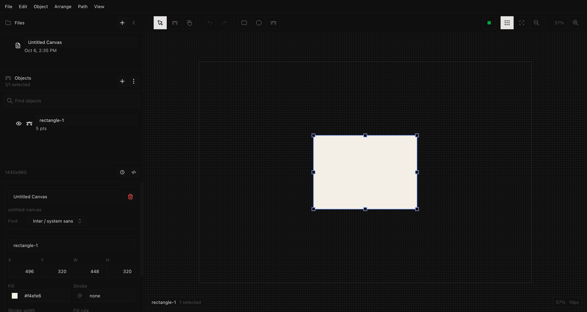

# design

A vector editor for SVG path documents, in the browser. Draw rectangles,
ellipses and lines, edit paths point by point, group and align, run boolean
operations, and keep a revision history per canvas. Everything is a `<path>`,
and the document you save is the SVG you see.



## Requirements

- [Bun](https://bun.sh)

## Run it

```sh
bun install
bun dev          # http://localhost:3000
```

The landing page is the editor. Canvases are saved to `./data/<slug>.json`
(with the current SVG beside it as `<slug>.svg`), so the folder is usable
without the app and nothing needs a database. Set `DESIGN_DATA_DIR` to put it
somewhere else, `PORT` to change the port.

## CLI and MCP

Every API route is available from the command line as `bun run cli`. Start an
API-only server with `HOST=127.0.0.1 bun run headless`, or connect the CLI to
the existing web server. Run `bun run cli --help` for commands; `DESIGN_API_URL`
or `--base-url` selects the server. The executable is also declared as
`design-cli` for `bun link`.

See [CLI.md](CLI.md) for examples, all commands, file and streaming I/O, exit
codes, and `bun run test:cli` verification.

The app is an MCP server too. Every API route is a tool, over streamable HTTP
at `POST /mcp` on the running server, or over stdio with `bun run mcp`
(`--start` gives it an API-only server of its own). Connect an agent with
`claude mcp add --transport http design http://localhost:3000/mcp`, or point
a stdio client at `mcp.js --start`. The executable is declared as `design-mcp`.

See [MCP.md](MCP.md) for connecting, every tool, how files and results are
handled, and `bun run test:mcp` verification.

## Layout

| Path                           | What                                                                                                             |
| ------------------------------ | ---------------------------------------------------------------------------------------------------------------- |
| `src/app/index.jsx`            | The page: document, selection, history, and the actions that change them                                         |
| `src/app/canvas.jsx`           | The canvas: pointer tools, handles, hit testing, drawing                                                         |
| `src/app/toolbar.jsx`          | Tools, zoom, and the Edit/Object/Arrange/Path/View menus                                                         |
| `src/app/layers-panel.jsx`     | Canvases and the object tree                                                                                     |
| `src/app/properties-panel.jsx` | Fill, stroke, bounds, source, revisions                                                                          |
| `src/app/shortcuts.js`         | The key table: an event resolves to an action name                                                               |
| `src/app/use-document-sync.js` | Load, autosave, documents list, revisions                                                                        |
| `src/app/storage.js`           | What the editor keeps in localStorage                                                                            |
| `src/app/client.js`            | The `/api` calls                                                                                                 |
| `src/lib/svg/`                 | The model: parsing, path math, hit testing, boolean ops (polygon-clipping), selection, layers, clipboard         |
| `src/ui/`                      | shadcn primitives (generated, see below), `tree-view`, `dropdown-select`, `icons`, `color/`                      |
| `src/shell/`                   | App frame: layout, menubar, `useAppMenu`, confirm/prompt dialogs                                                 |
| `src/server/store.js`          | File-backed documents and revisions                                                                              |
| `server.js`                    | `Bun.serve`: the page plus `/api/document(s)` and `/api/revisions`                                               |
| `src/styles/core.css`          | Tailwind v4 theme: five brand themes on ten slots (see Themes), no radius, one 11px/16px type size on a 4px grid |

## License

MIT — see [LICENSE](LICENSE).
